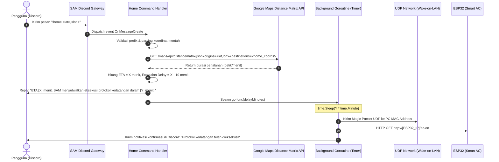

# SAM (Some Asshole's Machine) — Technical Blueprint & Architecture Document

SAM dirancang sebagai **"JARVIS on budget"** berbasis **Golang** yang bertindak sebagai antarmuka komando pusat via Discord. SAM bertugas mengorkestrasi server lokal, skrip otomasi, serta perangkat smart home (IoT) menggunakan arsitektur modular yang decoupled, efisien (ringan & konkurensi native via Goroutines), dan mudah dikembangkan di masa mendatang.

---

## 1. Arsitektur & Prinsip Desain

### 1.1 Prinsip Desain
1. **Modular Command Pattern**: Setiap command bot (misal: `!home`, `!status`, `!ping`) dipisahkan menjadi handler tersendiri dan didaftarkan melalui command registry terpusat.
2. **Non-blocking & Concurrent**: Operasi yang membutuhkan jeda/timer panjang (seperti penjadwalan kedatangan) atau I/O jaringan dijalankan pada background worker/goroutine terpisah agar Discord bot gateway tetap responsif merespons event lain.
3. **Environment-driven Configuration**: Semua kredensial rahasia, alamat IP, MAC address, dan koordinat statis disimpan di file `.env` dan dimuat ke dalam struct konfigurasi strongly-typed saat bot boot.
4. **Decoupled Network Utilities**: Fungsi jaringan seperti Wake-on-LAN (UDP Magic Packet), request HTTP REST ke microcontroller (ESP32), dan integrasi API pihak ketiga (Google Maps) diisolasi di package utilitas tersendiri.

### 1.2 Diagram Alur: Modul Protokol Kedatangan (`!home <lat>,<lon>`)



---

## 2. Struktur Folder Modular

```text
SAM/
├── cmd/
│   └── bot/
│       └── main.go                 # Entrypoint aplikasi (inisialisasi & gracefully shutdown)
├── config/
│   └── config.go               # Struct konfigurasi & loader .env (godotenv)
├── internal/
│   ├── bot/
│   │   ├── bot.go              # Setup discordgo session, register handlers & lifecycle
│   │   └── registry.go         # Registry dispatcher untuk mapping prefix/command ke handler
│   ├── handlers/
│   │   ├── handler.go          # Interface umum untuk command handler
│   │   ├── home.go             # Implementasi perintah !home (Protokol Kedatangan)
│   │   └── ping.go             # Contoh command sederhana (!ping)
│   ├── gmaps/
│   │   └── client.go           # HTTP client pembungkus Google Maps Distance Matrix API
│   └── network/
│       ├── wol.go              # Generator & pengirim UDP Magic Packet (Wake-on-LAN)
│       └── iot.go              # HTTP client untuk trigger endpoint REST ESP32
├── .env.example                # Template variabel environment
├── .gitignore                  # Mengabaikan file sensitif (.env, binary build)
├── go.mod                      # Dependensi module Go
└── go.sum                      # Checksum dependensi Go
```

---

## 3. Daftar Package & Dependensi

| Package | Repository | Fungsi |
| :--- | :--- | :--- |
| **DiscordGo** | `github.com/bwmarrin/discordgo` | Library resmi/komunitas Go untuk berinteraksi dengan Discord Gateway & REST API |
| **GoDotEnv** | `github.com/joho/godotenv` | Loader variabel dari file `.env` ke environment runtime Go |
| **Standard Net** | `net` & `net/http` (Standard Lib) | Pengiriman paket UDP Wake-on-LAN serta HTTP client komunikasi ke ESP32 & Google Maps |

---

## 4. Konfigurasi Environment (`.env`)

Buat file `.env` di root direktori project:

```env
# ==========================================
# DISCORD BOT CREDENTIALS
# ==========================================
DISCORD_TOKEN=Bot MTxxxxxxxxxxxxxxxxxxxxxxxxxxxxxx.xxxxxx.xxxxxxxxxxxxxxxxxxxxx
COMMAND_PREFIX=!

# ==========================================
# GOOGLE MAPS API & STATIC HOME COORDINATES
# ==========================================
# Format koordinat: latitude,longitude (tanpa spasi)
GMAPS_API_KEY=AIzaSyDxxxxxxxxxxxxxxxxxxxxxxxxxxxxxxx
HOME_COORDINATES=-6.2088,106.8456

# ==========================================
# AUTOMATION THRESHOLD & HARDWARE TARGETS
# ==========================================
# Threshold persiapan dalam menit (trigger dieksekusi [ETA - THRESHOLD] menit)
ARRIVAL_PREP_THRESHOLD_MINUTES=10

# Target PC Wake-on-LAN (Format MAC: XX:XX:XX:XX:XX:XX atau XX-XX-XX-XX-XX-XX)
PC_MAC_ADDRESS=AA:BB:CC:DD:EE:FF
WOL_BROADCAST_IP=255.255.255.255:9

# Target IoT Smart Home (ESP32 AC Controller)
ESP32_IP=192.168.1.50
```

---

## 5. Implementasi Kode Inti (Code Walkthrough)

### 5.1 `config/config.go`
```go
package config

import (
	"log"
	"os"
	"strconv"

	"github.com/joho/godotenv"
)

type Config struct {
	DiscordToken        string
	CommandPrefix       string
	GMapsAPIKey         string
	HomeCoordinates     string
	ArrivalPrepThreshold int
	PCMACAddress        string
	WoLBroadcastIP      string
	ESP32IP             string
}

func LoadConfig() *Config {
	if err := godotenv.Load(); err != nil {
		log.Println("[WARN] Tidak dapat memuat file .env, membaca dari environment sistem...")
	}

	threshold, err := strconv.Atoi(getEnv("ARRIVAL_PREP_THRESHOLD_MINUTES", "10"))
	if err != nil {
		threshold = 10
	}

	return &Config{
		DiscordToken:         getEnv("DISCORD_TOKEN", ""),
		CommandPrefix:        getEnv("COMMAND_PREFIX", "!"),
		GMapsAPIKey:          getEnv("GMAPS_API_KEY", ""),
		HomeCoordinates:      getEnv("HOME_COORDINATES", ""),
		ArrivalPrepThreshold: threshold,
		PCMACAddress:         getEnv("PC_MAC_ADDRESS", ""),
		WoLBroadcastIP:       getEnv("WOL_BROADCAST_IP", "255.255.255.255:9"),
		ESP32IP:              getEnv("ESP32_IP", ""),
	}
}

func getEnv(key, defaultVal string) string {
	if val, exists := os.LookupEnv(key); exists {
		return val
	}
	return defaultVal
}
```

### 5.2 Utilitas Jaringan: `internal/network/wol.go` & `iot.go`

#### Wake-on-LAN (`internal/network/wol.go`):
```go
package network

import (
	"fmt"
	"net"
)

// SendWakeOnLAN membuat dan mengirim Magic Packet (6 byte 0xFF + 16x MAC Address) via UDP
func SendWakeOnLAN(broadcastAddr, macStr string) error {
	hwAddr, err := net.ParseMAC(macStr)
	if err != nil {
		return fmt.Errorf("MAC address tidak valid: %w", err)
	}

	// Buat payload Magic Packet (102 bytes)
	var packet [102]byte
	copy(packet[0:6], []byte{0xFF, 0xFF, 0xFF, 0xFF, 0xFF, 0xFF})
	for i := 6; i < 102; i += len(hwAddr) {
		copy(packet[i:i+len(hwAddr)], hwAddr)
	}

	raddr, err := net.ResolveUDPAddr("udp", broadcastAddr)
	if err != nil {
		return fmt.Errorf("gagal resolve broadcast addr: %w", err)
	}

	conn, err := net.DialUDP("udp", nil, raddr)
	if err != nil {
		return fmt.Errorf("gagal dial UDP: %w", err)
	}
	defer conn.Close()

	if _, err := conn.Write(packet[:]); err != nil {
		return fmt.Errorf("gagal mengirim magic packet: %w", err)
	}

	return nil
}
```

#### IoT ESP32 Client (`internal/network/iot.go`):
```go
package network

import (
	"context"
	"encoding/json"
	"fmt"
	"net/http"
	"time"
)

type ESP32SensorData struct {
	Temperature   float64 `json:"temperature"`
	Humidity      float64 `json:"humidity"`
	Status        string  `json:"status"`
	UptimeSeconds int64   `json:"uptime_seconds"`
}

// GetESP32Temperature membaca sensor DHT22 melalui endpoint GET /temp
func GetESP32Temperature(ip string) (*ESP32SensorData, error) {
	url := fmt.Sprintf("http://%s/temp", ip)
	ctx, cancel := context.WithTimeout(context.Background(), 4*time.Second)
	defer cancel()

	req, err := http.NewRequestWithContext(ctx, http.MethodGet, url, nil)
	if err != nil {
		return nil, err
	}

	resp, err := http.DefaultClient.Do(req)
	if err != nil {
		return nil, fmt.Errorf("gagal request suhu ke ESP32 (%s): %w", url, err)
	}
	defer resp.Body.Close()

	if resp.StatusCode != http.StatusOK {
		return nil, fmt.Errorf("ESP32 merespons dengan status: %d", resp.StatusCode)
	}

	var data ESP32SensorData
	if err := json.NewDecoder(resp.Body).Decode(&data); err != nil {
		return nil, fmt.Errorf("gagal decode response suhu ESP32: %w", err)
	}

	return &data, nil
}

// TriggerESP32AC mengirim sinyal aktivasi AC melalui endpoint GET /ac-on
func TriggerESP32AC(ip string) error {
	url := fmt.Sprintf("http://%s/ac-on", ip)
	ctx, cancel := context.WithTimeout(context.Background(), 5*time.Second)
	defer cancel()

	req, err := http.NewRequestWithContext(ctx, http.MethodGet, url, nil)
	if err != nil {
		return err
	}

	resp, err := http.DefaultClient.Do(req)
	if err != nil {
		return fmt.Errorf("gagal trigger AC ke ESP32 (%s): %w", url, err)
	}
	defer resp.Body.Close()

	if resp.StatusCode >= 400 {
		return fmt.Errorf("ESP32 merespons error status: %d", resp.StatusCode)
	}

	return nil
}
```

### 5.3 Google Maps Client: `internal/gmaps/client.go`
```go
package gmaps

import (
	"encoding/json"
	"fmt"
	"net/http"
	"net/url"
	"time"
)

type DistanceMatrixResponse struct {
	Status string `json:"status"`
	Rows   []struct {
		Elements []struct {
			Status   string `json:"status"`
			Duration struct {
				Value int    `json:"value"` // dalam detik
				Text  string `json:"text"`
			} `json:"duration"`
		} `json:"elements"`
	} `json:"rows"`
}

func GetTravelDurationMinutes(apiKey, origin, destination string) (int, error) {
	baseURL := "https://maps.googleapis.com/maps/api/distancematrix/json"
	params := url.Values{}
	params.Add("origins", origin)
	params.Add("destinations", destination)
	params.Add("key", apiKey)

	client := &http.Client{Timeout: 10 * time.Second}
	resp, err := client.Get(fmt.Sprintf("%s?%s", baseURL, params.Encode()))
	if err != nil {
		return 0, err
	}
	defer resp.Body.Close()

	var dmResp DistanceMatrixResponse
	if err := json.NewDecoder(resp.Body).Decode(&dmResp); err != nil {
		return 0, err
	}

	if dmResp.Status != "OK" || len(dmResp.Rows) == 0 || len(dmResp.Rows[0].Elements) == 0 {
		return 0, fmt.Errorf("status response API tidak valid: %s", dmResp.Status)
	}

	elem := dmResp.Rows[0].Elements[0]
	if elem.Status != "OK" {
		return 0, fmt.Errorf("elemen rute status: %s", elem.Status)
	}

	durationMinutes := (elem.Duration.Value + 59) / 60
	return durationMinutes, nil
}
```

### 5.4 Command Registry & Handler Modular: `internal/handlers/`

#### Interface Command Handler (`internal/handlers/handler.go`):
```go
package handlers

import "github.com/bwmarrin/discordgo"

type CommandHandler interface {
	Name() string
	Help() string
	Execute(s *discordgo.Session, m *discordgo.MessageCreate, args []string) error
}
```

#### Protokol Kedatangan (`internal/handlers/home.go`):
```go
package handlers

import (
	"fmt"
	"log"
	"strings"
	"time"

	"github.com/bwmarrin/discordgo"
	"SAM/config"
	"SAM/internal/gmaps"
	"SAM/internal/network"
)

type HomeHandler struct {
	cfg *config.Config
}

func NewHomeHandler(cfg *config.Config) *HomeHandler {
	return &HomeHandler{cfg: cfg}
}

func (h *HomeHandler) Name() string {
	return "home"
}

func (h *HomeHandler) Help() string {
	return "Menghitung estimasi perjalanan dan menjadwalkan protokol kedatangan: !home <lat>,<lon>"
}

func (h *HomeHandler) Execute(s *discordgo.Session, m *discordgo.MessageCreate, args []string) error {
	if len(args) == 0 {
		s.ChannelMessageSend(m.ChannelID, "⚠️ Format salah. Gunakan: `!home <lat>,<lon>` (contoh: `!home -6.1754,106.8272`)")
		return nil
	}

	origin := strings.TrimSpace(args[0])

	etaMinutes, err := gmaps.GetTravelDurationMinutes(h.cfg.GMapsAPIKey, origin, h.cfg.HomeCoordinates)
	if err != nil {
		s.ChannelMessageSend(m.ChannelID, fmt.Sprintf("❌ Gagal mengambil rute Google Maps: %v", err))
		return err
	}

	delayMinutes := etaMinutes - h.cfg.ArrivalPrepThreshold
	if delayMinutes < 0 {
		delayMinutes = 0
	}

	replyMsg := fmt.Sprintf("📍 **ETA:** %d menit.\n🤖 SAM menjadwalkan eksekusi protokol kedatangan dalam **%d menit**.", etaMinutes, delayMinutes)
	s.ChannelMessageSend(m.ChannelID, replyMsg)

	// Goroutine non-blocking untuk timer & trigger hardware
	go func(scheduledDelay int, channelID string) {
		if scheduledDelay > 0 {
			time.Sleep(time.Duration(scheduledDelay) * time.Minute)
		}

		log.Printf("[PROTOKOL KEDATANGAN] Menjalankan Wake-on-LAN dan AC ESP32...")

		// 1. Kirim Wake-on-LAN
		wolErr := network.SendWakeOnLAN(h.cfg.WoLBroadcastIP, h.cfg.PCMACAddress)
		if wolErr != nil {
			log.Printf("[ERR] WoL gagal: %v", wolErr)
		}

		// 2. Baca Suhu Kamar dari DHT22 ESP32 (GET /temp)
		sensorData, sensorErr := network.GetESP32Temperature(h.cfg.ESP32IP)
		roomTempInfo := "Data suhu tidak tersedia"
		if sensorErr == nil {
			roomTempInfo = fmt.Sprintf("%.1f°C (Kelembapan: %.1f%%)", sensorData.Temperature, sensorData.Humidity)
			log.Printf("[INFO] Suhu ruangan saat ini: %s", roomTempInfo)
		} else {
			log.Printf("[WARN] Gagal membaca suhu ESP32: %v", sensorErr)
		}

		// 3. Tembak ESP32 AC (GET /ac-on)
		espErr := network.TriggerESP32AC(h.cfg.ESP32IP)
		if espErr != nil {
			log.Printf("[ERR] ESP32 AC gagal: %v", espErr)
		}

		// Feedback ke Discord setelah dieksekusi
		statusText := fmt.Sprintf("✅ **Protokol Kedatangan Selesai Dieksekusi!**\n- 🖥️ **PC**: Magic Packet WoL terkirim\n- 🌡️ **Suhu Kamar**: %s\n- ❄️ **AC**: Sinyal dinyalakan ke ESP32", roomTempInfo)
		if wolErr != nil || espErr != nil {
			statusText = fmt.Sprintf("⚠️ **Protokol selesai dengan beberapa kendala:**\n- WoL: %v\n- Suhu: %s\n- AC: %v", wolErr, roomTempInfo, espErr)
		}
		s.ChannelMessageSend(channelID, statusText)
	}(delayMinutes, m.ChannelID)

	return nil
}
```

### 5.5 Inisialisasi Discord & Entrypoint: `cmd/bot/main.go`
```go
package main

import (
	"log"
	"os"
	"os/signal"
	"strings"
	"syscall"

	"github.com/bwmarrin/discordgo"
	"SAM/config"
	"SAM/internal/handlers"
)

func main() {
	cfg := config.LoadConfig()
	if cfg.DiscordToken == "" {
		log.Fatal("DISCORD_TOKEN wajib diisi di .env")
	}

	dg, err := discordgo.New(cfg.DiscordToken)
	if err != nil {
		log.Fatalf("Gagal inisialisasi Discord session: %v", err)
	}

	// Registry command handler
	registry := make(map[string]handlers.CommandHandler)
	homeHandler := handlers.NewHomeHandler(cfg)
	registry[homeHandler.Name()] = homeHandler

	// Event listener message create
	dg.AddHandler(func(s *discordgo.Session, m *discordgo.MessageCreate) {
		// Abaikan pesan dari bot itu sendiri
		if m.Author.ID == s.State.User.ID {
			return
		}

		if !strings.HasPrefix(m.Content, cfg.CommandPrefix) {
			return
		}

		content := strings.TrimPrefix(m.Content, cfg.CommandPrefix)
		parts := strings.Fields(content)
		if len(parts) == 0 {
			return
		}

		cmdName := strings.ToLower(parts[0])
		args := parts[1:]

		if handler, exists := registry[cmdName]; exists {
			if err := handler.Execute(s, m, args); err != nil {
				log.Printf("[ERR] Handler %s gagal: %v", cmdName, err)
			}
		}
	})

	dg.Identify.Intents = discordgo.IntentsGuildMessages | discordgo.IntentsDirectMessages | discordgo.IntentsMessageContent

	if err = dg.Open(); err != nil {
		log.Fatalf("Gagal terhubung ke Discord Gateway: %v", err)
	}
	defer dg.Close()

	log.Println("🤖 SAM (Some Asshole's Machine) berhasil online! Tekan CTRL+C untuk berhenti.")

	// Menunggu sinyal OS interrupt (Graceful Shutdown)
	stop := make(chan os.Signal, 1)
	signal.Notify(stop, syscall.SIGINT, syscall.SIGTERM, os.Interrupt)
	<-stop

	log.Println("🛑 Mematikan SAM secara aman...")
}
```

---

## 6. Panduan Eksekusi Step-by-Step

### Langkah 1: Inisialisasi Proyek Go
Buka terminal di root direktori project `SAM`:
```bash
go mod init SAM
```

### Langkah 2: Unduh Dependensi Eksternal
Jalankan perintah berikut untuk mengunduh package:
```bash
go get github.com/bwmarrin/discordgo
go get github.com/joho/godotenv
go mod tidy
```

### Langkah 3: Setup File Konfigurasi `.env`
1. Salin template konfigurasi:
   ```bash
   cp .env.example .env
   ```
2. Isi nilai:
   - **`DISCORD_TOKEN`**: Buat Bot Application di [Discord Developer Portal](https://discord.com/developers/applications), aktifkan **Message Content Intent** di tab Bot.
   - **`GMAPS_API_KEY`**: Dapatkan dari Google Cloud Console dengan API **Distance Matrix API** aktif.
   - **`HOME_COORDINATES`**: Titik rumah Anda (format: `<latitude>,<longitude>`).
   - **`PC_MAC_ADDRESS`**: MAC address LAN adapter PC target (pastikan setting BIOS PC mengaktifkan *Wake on LAN* / *Power On By PCI-E*).
   - **`ESP32_IP`**: Alamat IP lokal ESP32 yang menjalankan webserver `/ac-on`.

### Langkah 4: Uji Coba & Jalankan Bot
Untuk menjalankan bot langsung:
```bash
go run ./cmd/bot/main.go
```

Atau kompilasi menjadi binary:
```bash
go build -o bin/sam.exe ./cmd/bot/main.go
./bin/sam.exe
```

### Langkah 5: Pengujian Modul Kedatangan di Discord
Ketik di channel Discord tempat SAM berada:
```text
!home -6.1754,106.8272
```
SAM akan merespons dengan estimasi ETA, menjadwalkan timer, dan menjalankan aktivasi hardware (WoL + HTTP ESP32) setelah timer habis.
